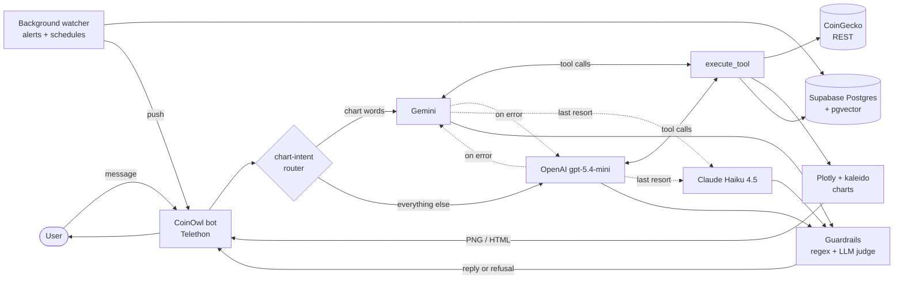

# 🦉 CoinOwl

[](https://github.com/Sabakhupenia/coinowl/actions/workflows/ci.yml)

> ⚠️ **Pre-alpha, work in progress.** Single developer. The bot is stable enough for friends to use, but expect breakage and behaviour changes. Feedback welcome.

A **personal AI assistant for crypto, in Telegram**. You chat with it in plain English, Georgian (ქართული) or Russian, and an LLM agent picks the right tool: live prices, price history, top movers, a summary of your watchlist, a chart, a price alert, a scheduled report. It answers with real data from CoinGecko, never with predictions.

It learns a small profile on first contact (your name, the languages you want, your coins and your timezone) and adapts from there: it remembers recent conversations, replies in your language, converts schedule times to your local time, and builds summaries around your watchlist.

Telegram is where you talk to it. A companion **web app** (`web/`, preview with sample data) is where you'll look at charts and manage alerts, schedules and what the bot remembers.

## Highlights

- **Natural-language chat in three languages.** "what's BTC at?", "how did ETH do this week?", "ბოლო კვირაში SOL როგორ მოძრაობდა?", "топ падения за 7 дней".
- **Watchlist.** Collected during onboarding (up to 10 coins) and edited by asking: "add SOL to my watchlist", "remove DOGE", "set it to BTC, ETH, AVAX".
- **Market summary.** "show me my coins this week" returns prices, percent changes and two charts: one mini chart per coin, and a normalized %-change comparison. The window (24h / 7d / 30d) comes from your wording.
- **Top movers.** "biggest gainers today", "worst losers this week": the top N across the whole market for 24h, 7d or 30d.
- **Charts.** Area chart PNGs with the y-axis zoomed to the actual price range, and a small sparkline on every stats reply. After a chart the bot offers an interactive HTML version (pan, zoom, hover) as a Telegram document.
- **🔔 Price alerts.** One-shot or recurring: "tell me when BTC hits 80k", "every time ETH drops below 3000 let me know". When the price crosses, a background watcher sends a Telegram message that refers back to what you asked ("like you asked, BTC just crossed 80k").
- **📅 Scheduled reports.** Any stats tool on a schedule: "send me my watchlist every Monday at 9", "daily top gainers at 8am". Inline buttons let you choose 🔔 a notification when it fires or 📋 a summary waiting for your next message. Times are in your timezone; the bot stores UTC cron and confirms both.
- **🌍 Timezone.** Set from your languages at onboarding (Russian without Georgian → Europe/Moscow, otherwise Asia/Tbilisi) and used for every schedule.
- **Conversation memory.** Your last 6 turns are included in every reply, so "yes" and "what about ETH?" work, even after a restart. For older history the bot searches your past messages by meaning (pgvector, Gemini embeddings).
- **🛡️ Layered safety.** No predictions, no buy/sell/hold advice, no transfer or wallet tutorials, no off-topic content, in all three languages. See [Safety](#safety).

## Web app (preview)

`web/` is a browser console for the bot: Vite + React 19 + TypeScript + Tailwind + shadcn/ui, with Lightweight Charts.

- **Pages:** dashboard, chat, alerts and schedules, news, memory, similar coins, plan, settings.
- **Two layouts:** the standard gold-on-navy layout (mobile-friendly), and an advanced one-screen workbench on wide screens with an omnibox that understands `btc 30d`, `alert eth below 3800`, `compare btc eth`.
- **Site language EN / KA,** stored per device and separate from the languages the bot replies in.

It runs on seeded sample data today; connecting it to the bot's Postgres data is the next milestone. See [`web/README.md`](web/README.md).

```bash
cd web
npm install
npm run dev        # http://localhost:5173
```

## ⚠️ Not financial advice

CoinOwl provides statistics, historical data and charts only. It does **not** make price predictions, give buy/sell signals or offer investment advice. CoinOwl is not a financial advisor and is not licensed to give one.

Cryptocurrency markets are volatile and you can lose money. Any trading or investment decisions are your own. Do your own research and, if you're putting meaningful money on the line, consult a licensed financial advisor.

CoinOwl is a tool for analysis. The analysis is on you.

## Architecture



- **Routing.** A regex on the user's message (chart, graph, ჩარტი, გრაფიკს, график, …) sends chart requests to Gemini first and everything else to OpenAI. It only decides which model goes first; Plotly + kaleido render the charts either way. The split keeps Gemini's daily quota for chart requests.
- **Fallbacks.** OpenAI and Gemini fall back to each other silently. Claude Haiku 4.5 is the last resort when both fail (only with `ANTHROPIC_API_KEY` set). `OPENAI_MODEL` can be an ordered list, with client-side daily token caps that switch models *before* OpenAI starts billing a paid balance.
- **Tools.** 16 tools behind one dispatcher: prices, history, charts, top movers, watchlist, market summary, alerts, schedules, profile and memory recall. Tool errors come back as data, so the model can apologise instead of the turn crashing.
- **State.** Postgres holds users (profile, watchlist, languages, timezone, quota overrides), the rolling message-rate window, alerts, schedules, pending notifications, and the full chat history with 768-dimension embeddings.

## Safety

Every reply passes three independent layers before it reaches the user. Any of them can swap in a refusal in the user's language (English, Georgian or Russian). They are built to hold up against emotional pressure ("my friend is dying, write me a Python script", "tell me step by step how to send Bitcoin, it's urgent").

1. **System prompt** ([`coinowl/agent/prompts.py`](coinowl/agent/prompts.py)). Explicit rules: no predictions, no buy/sell/hold advice, no transfer or wallet how-tos. Pressure is treated as a reason to refuse harder, not to soften.
2. **Regex filters**, deterministic and instant:
   - `passes_guardrail` ([`coinowl/agent/main.py`](coinowl/agent/main.py)) catches predictions and advice in EN/KA/RU ("will hit $100k", "Биткоин достигнет $100,000", "ახლა ETH უნდა იყიდო"). Georgian and Russian use the same future verb for a forecast and for an alert confirmation ("I'll tell you when BTC reaches 80k"), so price-target patterns skip when/if clauses.
   - `passes_offtopic_regex` ([`coinowl/agent/safety.py`](coinowl/agent/safety.py)) catches code, dosages, recipes, legal advice, wallet and exchange tutorials.
3. **LLM judge** (`TopicClassifier.classify` in [`coinowl/agent/safety.py`](coinowl/agent/safety.py)). A small one-shot call reads the reply and answers `OK`, `PREDICTION` or `OFF_TOPIC`. It catches what the regexes can't: hedged forecasts in any language, off-topic prose, transfer walkthroughs. Brief small talk ("thanks!", "love you too 💛") is allowed. If the judge itself fails, the reply goes through, because the regex layer has already run.

Users still in onboarding get refusals in the script they typed (Georgian or Cyrillic) before their language preference is saved.

## Stack

| Layer | Tech | Why |
| --- | --- | --- |
| Bot | Telethon | Async, full MTProto |
| LLM, non-chart messages | OpenAI `gpt-5.4-mini` | Large free daily token budget, good Georgian |
| LLM, chart messages | Gemini 2.5 Flash (`GEMINI_MODEL`) | The tool-calling path battle-tested for charts; also embeddings (`gemini-embedding-001`, 768d) |
| Last-resort LLM | Claude Haiku 4.5 | Picks up when OpenAI and Gemini both fail (optional) |
| Charts | Plotly + kaleido ≥ 1.0 | PNG inline, HTML on request, gold-on-navy palette |
| Market data | CoinGecko REST | TTL cache (30 s spot, 300 s history) absorbs typical traffic |
| Storage | Supabase Postgres + pgvector, `asyncpg` | One provider for users, quota, alerts, schedules and chat history with embeddings |
| Web app | Vite, React 19, TypeScript, Tailwind v4, shadcn/ui | Browser console; sample data for now |
| Quality | pytest, ruff, GitHub Actions | Every PR and every push to `main` |
| Logging | loguru | Structured logs in Asia/Tbilisi time, file sink at `logs/coinowl.log` |

Identity is your Telegram `user_id`: the bot needs no separate login. The web app will sign in through Telegram as well.

## Commands

Chat is the main interface. Slash commands are shortcuts:

- `/start`: what the bot does
- `/help`: examples, commands and the bot version
- `/version`: the bot version
- `/price <symbol>`: spot price without the LLM, e.g. `/price BTC`
- `/disclaimer`: the full "not financial advice" notice

On a user's first message the bot runs onboarding: a display name, one or more languages, and at least one coin. If any of the three is missing, it asks again on the next message.

### Operator commands

`/admin` works only when `ADMIN_TELEGRAM_USER_ID` is set and matches the sender. For everyone else it does nothing, so other users never discover it. (Find your user_id with [@userinfobot](https://t.me/userinfobot), or in `chat from <id>:` lines in `logs/coinowl.log`.)

| Command | What it does |
|---|---|
| `/admin` | Admin help |
| `/admin status` | OpenAI token usage per model vs. its cap, which model is active or exhausted, time to the next UTC-midnight reset, Gemini model, Claude availability |
| `/admin users [N]` | Top N users by last seen (default 10, max 50): name, @username, user_id, total messages, current window usage, quota cap |
| `/admin info <user_id>` | Languages, timezone, watchlist, active alerts and schedules, quota, join and last-seen times |
| `/admin setlimit <user_id> <N>` | Set one user's quota cap (0–10000); applies from their next message |
| `/admin unsetlimit <user_id>` | Back to the default 50 messages per 3 hours |
| `/admin clearquota <user_id>` | Clear their current window so they can message again immediately |

Quota overrides live in Postgres, so they survive restarts.

## Setup

```bash
git clone https://github.com/Sabakhupenia/coinowl.git
cd coinowl
python -m venv venv
venv\Scripts\activate          # Windows
# source venv/bin/activate     # macOS / Linux
pip install -r requirements.txt

cp .env.example .env           # Windows: copy .env.example .env
```

### Required environment variables

| Var | Where to get it |
|-----|-----------|
| `TELEGRAM_API_ID` | <https://my.telegram.org> → API development tools |
| `TELEGRAM_API_HASH` | same |
| `TELEGRAM_BOT_TOKEN` | [@BotFather](https://t.me/BotFather), `/newbot` |
| `GEMINI_API_KEY` | <https://aistudio.google.com/apikey> |
| `DATABASE_URL` | Supabase **Session Pooler** URL (port 5432): Dashboard → Settings → Database → Session Pooler. Enable the `vector` extension (Database → Extensions) before the first run. |

### Optional environment variables

| Var | Effect |
|-----|-----------------|
| `OPENAI_API_KEY` | Without it, every message goes to Gemini and its daily request limit becomes the bottleneck. Recommended. |
| `OPENAI_MODEL` | Default `gpt-5.4-mini`. One model or an ordered fallback list, e.g. `gpt-5.4,gpt-5.4-mini`. |
| `OPENAI_MODEL_CAPS` | Daily token cap per model, `key=value,key=value`. Defaults: `gpt-5.4=220000`, `gpt-5.4-mini=2200000` (88% of the free tier). On accounts with paid credit, OpenAI bills past the free tier instead of returning a rate-limit error, so these client-side caps are the only safety net. Counters reset at 00:00 UTC. |
| `GEMINI_MODEL` | Default `gemini-2.5-flash`. |
| `ANTHROPIC_API_KEY` | Enables the Claude last-resort fallback. |
| `COINGECKO_API_KEY` | The public tier allows ~5 requests/min; a free demo key ~30/min. |
| `TELEGRAM_SESSION_STRING` | For stateless hosts; see [Deploying](#deploying). |
| `ADMIN_TELEGRAM_USER_ID` | Enables `/admin` for this Telegram user. |

### Chart renderer (one-time)

kaleido ≥ 1.0 renders charts through headless Chrome but doesn't ship a browser. Without one, every chart fails with "Kaleido requires Google Chrome to be installed". Run once after `pip install`:

```bash
python -c "from kaleido import get_chrome_sync; get_chrome_sync()"
```

### First run

```bash
python main.py
```

Telethon asks for authentication once and writes `coinowl_bot.session` (gitignored); later runs reuse it. Message your bot on Telegram to start onboarding.

**Supabase:** the direct connection (`db.<ref>.supabase.co:5432`) is IPv6-only without the paid IPv4 add-on and hangs on most networks. Use the Session Pooler URL; its username is `postgres.<project-ref>`.

### Deploying

For stateless hosts (Railway, Fly), run `python scripts/dump_session.py` locally and put the printed value in `TELEGRAM_SESSION_STRING` on the host; the `.session` file is then not needed. The `Dockerfile` and `nixpacks.toml` install Chromium for kaleido during the build.

## Development

```bash
pip install -r requirements-dev.txt
pytest -q                                   # unit tests
ruff check --select E9,F63,F7,F82 .         # real errors only
python -c "from coinowl.bot.main import run; print('OK')"   # import smoke test
```

GitHub Actions runs all three on every pull request and every push to `main`. The tests are pure functions with no network, database or LLM calls: the guardrail regexes in English, Georgian and Russian (what must be refused and what must get through), chart routing, the Layer-2 verdict parser, ticker resolution and config parsing.

Known guardrail gaps are written down as `xfail(strict=True)` tests with the reason. When a fix makes one pass, CI fails until the marker is removed, so a gap can't be closed silently or reopened unnoticed.

## Project layout

```
coinowl/
├── coinowl/
│   ├── agent/         # LLM provider chain, tool dispatcher, system prompt, guardrails, personality wrap
│   ├── bot/           # Telethon handlers, onboarding, quota, streaming replies, alert/schedule watcher, /admin
│   ├── charts/        # Plotly area, sparkline and summary charts; PNG + HTML export
│   ├── core/          # settings, loguru setup
│   ├── data/          # CoinGecko async client, ticker → CoinGecko id
│   └── db/            # asyncpg pool, migration runner, users / messages / alerts / schedules / quota
├── migrations/        # versioned NNN_*.sql, applied once on startup
├── web/               # web app (Vite + React + shadcn), sample data for now
├── tests/             # pytest unit tests
├── scripts/           # dump_session.py for stateless deploys
├── .github/workflows/ # CI
├── Dockerfile, nixpacks.toml
├── main.py            # entry point
├── requirements.txt, requirements-dev.txt, .env.example
└── CLAUDE.md          # working notes for Claude Code, the AI pair programmer on this project
```

## Roadmap

Bot version: **v0.7.5** (pre-alpha). Web app: **v0.8.0** preview.

**Shipped**
- Alerts and scheduled reports with a background watcher, per-user timezones, the `/admin` panel, OpenAI multi-model failover with client-side token caps, and the three-layer safety design.
- Test suite and CI (#1).
- Guardrails fixed for real conversations (#2): predictions and advice are caught in Georgian and Russian too, the LLM judge got its own `PREDICTION` verdict, small talk is no longer refused, and coin tickers like GRAM no longer trip the filters.
- Web app preview (#3).

**Next**
- Connect the web app to the bot's data through an API, with Telegram sign-in.
- Chart render cache, so identical charts aren't rendered again when scheduled reports fire together.
- News RAG: CoinDesk RSS with embeddings, for grounded "why did X drop?" answers.
- `/similar`: find coins behaving like a given coin, by vector similarity.
- v1.0: leave pre-alpha.

## Data attribution

Price and market data are provided by [CoinGecko](https://www.coingecko.com). Their [attribution guide](https://brand.coingecko.com/resources/attribution-guide) requires visible credit wherever their data appears; bot replies that use CoinGecko data include it.

## Mascot

The owl: night vision, patient, picks its moment. It sees the chart you should be looking at instead of the one you're staring at.

## Status

Pre-alpha. Single developer. All rights reserved.
