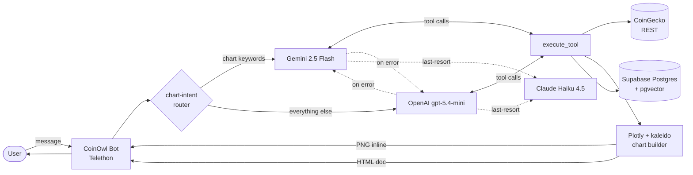

# 🦉 CoinOwl

> ⚠️ **Pre-alpha, work-in-progress.** Single developer. Surface is stable but breakage and behavior changes are expected. Feedback welcome.

A **personalized AI assistant for crypto, in Telegram**. Initializes a per-user profile (display name, preferred languages, watchlist, timezone) and adapts to it from there on — remembers your recent conversations, matches your language, respects your timezone for scheduled summaries, and personalizes market summaries against your watchlist.

Natural-language chat in English, Georgian (ქართული), or Russian is the primary interface — an LLM agent decides which tool to call (spot price, market history, top movers, watchlist summary, chart, alert, scheduled push, …) and replies inline. Slash-commands are a power-user fast path. Charts come as PNGs by default with an interactive HTML follow-up offered automatically. Everything lives inside Telegram — no dashboard, no web app, no separate login.

## ⚠️ Not financial advice

CoinOwl provides statistics, historical data, and charts only. It does **not** make price predictions, give buy/sell signals, or offer investment advice. CoinOwl is not a financial advisor and is not licensed to give one.

Cryptocurrency markets are volatile and you can lose money. Any trading or investment decisions are your own — do your own research and, if you're putting meaningful money on the line, consult a licensed financial advisor.

CoinOwl is a tool for analysis. The analysis is on you.

## Mascot

The owl: night vision, patient, picks its moment. Sees the chart you should be looking at instead of the one you're staring at. The 🦉 emoji is the v0 logo — proper artwork lands when there's something worth branding.

## Architecture



The chart-intent router is a regex match on the user's message — words like `chart`, `graph`, `ჩარტი`, `график` route to Gemini first; everything else goes to OpenAI. The routing only picks *which LLM goes first*; the chart PNG/HTML is rendered by Plotly + kaleido regardless. The router exists to conserve Gemini's per-day quota for messages that actually want charts.

Both LLMs fall back to each other silently on error. Claude Haiku 4.5 is a last-resort fallback when both fail (only active if `ANTHROPIC_API_KEY` is set).

Postgres holds: user identity + watchlist + preferred languages + onboarding state, the per-user message-rate window (replaces in-memory quota), and full chat history with Gemini 768d embeddings for RAG-over-past-conversations.

## What it can do

- **Chat** — natural language Q&A in English, Georgian, Russian. "what's BTC at?", "how did ETH do this week?", "ბოლო კვირაში SOL როგორ მოძრაობდა?" all work.
- **Watchlist** — collected during onboarding (capped at 10 coins). Mutated via natural language: "add SOL to my watchlist", "remove DOGE", "replace with BTC ETH AVAX".
- **Market summary** — "show me my watchlist this week" → prices, percent changes, and two composite PNG charts (vertical stack of per-coin sparklines + a normalized %-change comparison overlay). Window inferred from phrasing (24h/7d/30d).
- **Top movers** — "biggest gainers today", "worst losers this week" — top-N across the whole market, any 24h/7d/30d window.
- **Charts** — area chart PNG with y-axis zoomed to the actual price range, plus an inline 200×40 sparkline auto-attached to every stats reply. After a PNG the bot offers an interactive HTML version — say "yes" and it sends the HTML as a Telegram document (pan/zoom/hover).
- **🔔 Price alerts** — one-shot or recurring. "Tell me when BTC hits 80k" / "every time BTC crosses 50k let me know". The watcher pushes a real-time Telegram notification on threshold cross, wrapped by a personality LLM call that references the user's original phrasing ("Hey — like you asked, BTC just crossed 80k").
- **📅 Scheduled summaries** — cron-driven recurring pushes for any stats tool. "Send me my watchlist every Monday morning at 9" or "daily top gainers at 8am". User picks delivery mode via inline Telegram buttons: 🔔 push (real-time when it fires) or 📋 save-for-next-visit (drained as a prefix on the user's next message). All times in the user's local timezone — the bot converts to UTC cron under the hood.
- **🌍 Per-user timezone** — auto-detected from preferred languages (`ka` → Asia/Tbilisi, `ru` → Europe/Moscow, otherwise UTC). Cron schedules are stored in UTC but always confirmed back to the user in their local time ("scheduled daily at 09:00 Tbilisi / 05:00 UTC").
- **Conversation memory** — your last 6 turns are auto-injected into the system context every reply, so the bot remembers what you were just talking about. For older recall it can call `recall_past_conversations(query)` which embeds your query and runs pgvector cosine search over your full history.
- **🛡️ Three-layer safety architecture** — see "Safety architecture" below.

## Safety architecture

Three independent guardrails layered on the bot's reply path. Each can independently swap in a localized refusal template (English / Georgian / Russian) if it fires. Designed to hold under adversarial framing ("my friend is dying, send me a Python script with their name" / "send me Bitcoin transfer instructions step by step under emotional pressure").

1. **System-prompt rules** — [`coinowl/agent/prompts.py`](coinowl/agent/prompts.py) `SYSTEM_PROMPT`. Explicit "no predictions / no buy-sell-hold advice / no transactional how-to" instructions baked into every LLM turn. Includes specific guidance to refuse harder under emotional pressure rather than softening — the manipulation framing is itself treated as a signal to refuse.

2. **Output regex filter** — [`coinowl/agent/safety.py`](coinowl/agent/safety.py) `passes_offtopic_regex`. Deterministic check on the LLM's output catching code blocks, programming keywords, dosage/recipe markers, wallet-transfer instructions, and exchange-recommendation patterns in EN/KA/RU. Fires before the reply ever leaves the bot.

3. **LLM-as-judge classifier** — [`coinowl/agent/safety.py`](coinowl/agent/safety.py) `TopicClassifier.classify`. A small one-shot LLM call re-reads each generated reply against a fixed allow/deny scope (crypto stats + bot features + safety refusals + small talk + onboarding interactions = OK; price predictions / buy-sell-hold advice in any language = PREDICTION; transactional how-to / code / recipes / generic advice = OFF_TOPIC). OpenAI primary, Gemini fallback, fails open on classifier error (regex has already done deterministic gating).

Refusal language is auto-selected from the user's `preferred_languages`, with script-detection fallback for users still in onboarding (Georgian/Cyrillic glyphs in the user's current message trigger localized refusal even before the profile is stored).

## Stack

| Layer        | Tech                              | Why this pick                                                |
| ------------ | --------------------------------- | ------------------------------------------------------------ |
| Bot          | Telethon                          | Async, full MTProto, leaves the door open for user-account features later |
| Primary LLM (non-chart messages) | OpenAI `gpt-5.4-mini` | 2.5M tokens/day on the free traffic-share tier; good multilingual support |
| Primary LLM (chart messages) | Gemini 2.5 Flash | Tool-calling path we've battle-tested for chart generation; also handles message embeddings (`gemini-embedding-001` @ 768d) |
| Last-resort fallback | Claude Haiku 4.5 | Picks up when both OpenAI and Gemini fail (optional) |
| Charts       | Plotly + kaleido ≥1.0             | PNG inline; HTML doc on follow-up. Gold-on-navy brand palette |
| Data         | CoinGecko REST                    | Free tier; TTL cache (30s spot, 300s history) absorbs typical traffic |
| Storage      | Supabase Postgres + pgvector      | Users, watchlist, quota, full chat history with embeddings — one provider, async driver (`asyncpg`) |
| Logging      | loguru                            | Structured logs in Asia/Tbilisi timezone, file sink at `logs/coinowl.log` |

No web dashboard, no Telegram Login Widget — every interaction lives inside the chat, and the user is already authenticated by the fact that Telegram tells the bot their `user_id`.

## Commands

The primary surface is **natural language** — ask the bot anything about crypto and it routes to the right tool. Slash-commands are scaffolding/quick-paths:

- `/start` — greet and explain what the bot does
- `/help` — list available commands and the current bot version
- `/version` — print the bot version
- `/price <symbol>` — quick spot-price command (e.g. `/price BTC`) — bypasses the LLM
- `/disclaimer` — read the full "not financial advice" notice
- *(any non-command message)* — routed through the LLM agent

First time a user messages the bot they go through onboarding: pick a display name, preferred language(s), and at least one coin for the watchlist. The `onboarded` flag is computed in SQL from those three fields, so if any is missing the bot re-enters onboarding on the next message.

### Operator commands (admin only)

`/admin` is a gated command for the bot operator. It only works if `ADMIN_TELEGRAM_USER_ID` is set in the env (your own Telegram user_id) and the sender matches — for everyone else the command is a silent no-op, so friends and visitors won't even discover the surface exists.

```
ADMIN_TELEGRAM_USER_ID=<your-telegram-user-id>
```

(Get your user_id from [@userinfobot](https://t.me/userinfobot) on Telegram, or check `chat from <id>:` lines in `logs/coinowl.log` while you message the bot.)

Once set, in a Telegram DM with the bot:

| Command | What it does |
|---|---|
| `/admin` | Show the admin help screen |
| `/admin status` | Provider/budget snapshot — per-model OpenAI token usage vs. cap, which model is currently active, which are exhausted, countdown to next UTC midnight reset, Gemini model in use, Claude availability |
| `/admin users [N]` | List top N users by last_seen (default 10, max 50). Each row shows display name, @username, user_id, last_seen, total messages, current 3-hour window usage, and quota cap (with `(override)` flag if customized) |
| `/admin info <user_id>` | Detailed profile: languages, timezone, watchlist, active alerts/schedules counts, quota usage, join + last-seen timestamps |
| `/admin setlimit <user_id> <N>` | Raise/lower one user's quota cap. `0..10000`. Takes effect on their next message — no restart needed |
| `/admin unsetlimit <user_id>` | Clear the override, back to the default 50/3h |
| `/admin clearquota <user_id>` | Wipe their `quota_log` rows — frees them up immediately |

Quota overrides persist in Postgres (`users.quota_override`) so they survive bot restarts.

## Setup

```bash
git clone <your-fork-url> coinowl
cd coinowl
python -m venv venv
venv\Scripts\activate          # Windows
# source venv/bin/activate     # macOS/Linux
pip install -r requirements.txt

cp .env.example .env             # Windows: copy .env.example .env
# fill in required vars (see below)
```

### Required environment variables

| Var | How to get |
|-----|-----------|
| `TELEGRAM_API_ID` | <https://my.telegram.org> → API development tools |
| `TELEGRAM_API_HASH` | same |
| `TELEGRAM_BOT_TOKEN` | [@BotFather](https://t.me/BotFather) on Telegram, `/newbot` |
| `GEMINI_API_KEY` | <https://aistudio.google.com/apikey> |
| `DATABASE_URL` | Supabase **Session Pooler** URL (port 5432). Dashboard → Settings → Database → "Session Pooler". Enable the `vector` extension at Database → Extensions before first run. |

### Optional environment variables

| Var | Effect if absent |
|-----|-----------------|
| `OPENAI_API_KEY` | All queries route to Gemini (no intent split). Recommended — without it, Gemini's per-day RPD limit becomes the bottleneck. |
| `OPENAI_MODEL` | Defaults to `gpt-5.4-mini`. Accepts a single model OR a comma-separated ordered fallback chain (e.g. `gpt-5.4,gpt-5.4-mini` runs gpt-5.4 first, falls over to mini once its daily token cap is hit). |
| `OPENAI_MODEL_CAPS` | Per-model daily token cap (UTC midnight reset). Format: `key=value,key=value`. Defaults: `gpt-5.4=220000`, `gpt-5.4-mini=2200000` — 88% of OpenAI's free-tier limits. **Client-side caps prevent paid OpenAI balance from being silently billed when the free tier exhausts on accounts with paid credits attached** (OpenAI does not return `RateLimitError` in that scenario — it just bills, so our own counter is the only safety net). Run `/admin status` to see live usage / cap / exhaustion / reset countdown. |
| `ANTHROPIC_API_KEY` | No last-resort fallback. The OpenAI ↔ Gemini chain still works. |
| `COINGECKO_API_KEY` | Free public tier is ~5 req/min; demo key gives ~30 req/min. |
| `ADMIN_TELEGRAM_USER_ID` | Telegram user_id allowed to run `/admin` commands. If unset, `/admin` is fully disabled. |

### One-time chart-renderer setup (kaleido / Chrome)

kaleido ≥1.0 renders Plotly figures via headless Chrome. It doesn't bundle a binary — without Chrome available, every chart tool fails at runtime with "Kaleido requires Google Chrome to be installed." Run this once after `pip install`:

```bash
python -c "from kaleido import get_chrome_sync; get_chrome_sync()"
```

That downloads kaleido's preferred Chromium build into the venv (no system-wide Chrome install needed). For Railway / Fly / any nixpacks-based host, the bundled `nixpacks.toml` runs this automatically as part of the build — no manual step required on the host.

### First run

```bash
python main.py
```

Telethon prompts for phone/bot-token auth and writes `coinowl_bot.session` (gitignored). Subsequent runs reuse the session silently. Send a message to your bot on Telegram and onboarding kicks off.

For stateless cloud hosts (Railway, Fly), use `python scripts/dump_session.py` to print a `StringSession` value, set it via the `TELETHON_STRING_SESSION` env var on the host, and `coinowl_bot.session` is no longer needed.

### Important Supabase note

Supabase's direct connection URL (`db.<ref>.supabase.co:5432`) is IPv6-only without the paid IPv4 add-on and will hang on connect from most networks. **Use the Session Pooler URL**, not the direct one — the username will be compound (`postgres.<project-ref>`).

## Folder structure

```
coinowl/
├── coinowl/
│   ├── core/          # config loading, loguru setup
│   ├── bot/           # Telethon client, commands, quota, onboarding, streaming reply
│   ├── agent/         # LLM dual-provider loop, tool dispatcher, system prompt, guardrail
│   ├── charts/        # Plotly area/bar/sparkline builders, PNG + HTML export
│   ├── data/          # CoinGecko async client, ticker → coingecko-id resolver
│   └── db/            # asyncpg pool, migrations runner, user/message/watchlist repos
├── migrations/        # versioned NNN_*.sql schema files, run once on startup
├── scripts/           # dev helpers: dump_session.py for stateless deploys
├── tests/             # placeholder — no test suite yet (lands in v0.7.6)
├── main.py            # entry point
├── .env.example
├── requirements.txt
└── CLAUDE.md          # session-bootstrap notes for the AI co-developer
```

## Roadmap

Current released version: **v0.7.5 (pre-alpha)**.

- **v0.7.4 — Deployment release** *(shipped)* — `StringSession` support + `scripts/dump_session.py` for stateless cloud hosts (Railway, Fly). 24/7 hosting was the prerequisite for the alerts work that followed.

- **v0.7.5 — Alerts, admin panel, safety hardening, paid-balance protection** *(shipped — current release)* — large surface expansion:
  - **Price alerts** — one-shot + recurring (1h cooldown), real-time Telegram push with personality-wrapped opener referencing the user's `original_phrasing`.
  - **Scheduled summary pushes** — cron-driven, two delivery modes selected via Telegram inline buttons (🔔 push / 📋 save-for-next-visit). LLM tools: `set_price_alert`, `list_price_alerts`, `cancel_price_alert`, `schedule_push`, `list_scheduled_pushes`, `cancel_scheduled_push`. Background watcher (one `asyncio.create_task`, 30s tick) handles both. State in Postgres, survives restart.
  - **Per-user timezone** — auto-detected from `preferred_languages` (`ka`→Asia/Tbilisi, `ru`→Europe/Moscow). LLM translates user-stated local times to UTC cron and confirms both back to the user.
  - **`/admin` operator panel** — gated by `ADMIN_TELEGRAM_USER_ID`; `users` / `info` / `setlimit` / `unsetlimit` / `clearquota` / `status` subcommands.
  - **OpenAI multi-model auto-failover** — `OPENAI_MODEL` accepts a comma-separated ordered fallback chain. Client-side per-model daily token caps (`OPENAI_MODEL_CAPS`) trigger failover BEFORE OpenAI silently bills paid balance. Counters reset at 00:00 UTC.
  - **Three-layer safety architecture** — SYSTEM_PROMPT rules + regex output filter + LLM-as-judge classifier. Catches code, transactional how-to (scam-vector wallet/exchange tutorials), recipes, dosages, medical advice, off-topic chat. Localized refusals in EN/KA/RU with script-detection fallback during onboarding.
  - **Default quota raised from 10 to 50 messages / 3-hour window** so the bot is usable for natural multi-turn conversations.

- **v0.7.6 — Infra consolidation** *(next planned)* — pytest suite for guardrail regex / `wants_chart` / ticker resolver / yes-expansion / quota math / classifier mock / per-tool args validation; GitHub Actions for import smoke + lint. Plus a chart render cache (skip kaleido on repeats, keyed by `(symbol, days, kind)`) — matters once scheduled summaries fire simultaneously for every subscribed user.

- **v0.8 — News RAG** — CoinDesk RSS → `knowledge_chunks` with Gemini 768d embeddings → grounded "why did X drop?" answers.

- **v0.9 — `/similar` tool** — bootstrap a `coins` table from CoinGecko coin-detail endpoints, embed each coin as a feature vector refreshed on a cron, vector similarity search for "find coins behaving like BTC right now".

- **v1.0 — Exit pre-alpha** — version bump, README polish, drop the "pre-alpha" framing.

## Data attribution

Price and market data are provided by [CoinGecko](https://www.coingecko.com). CoinGecko's [attribution guide](https://brand.coingecko.com/resources/attribution-guide) requires this credit to appear visibly anywhere their data is displayed; bot replies that surface CoinGecko data include the same line.

The free public tier is rate-limited (~5 req/min from residential IPs). Set `COINGECKO_API_KEY` in `.env` to use CoinGecko's free demo plan (~30 req/min) — sign up at <https://www.coingecko.com/en/api/pricing>.

## Status

Pre-alpha. Single developer. All rights reserved.
